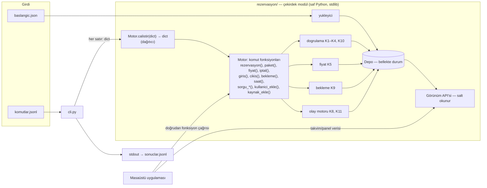
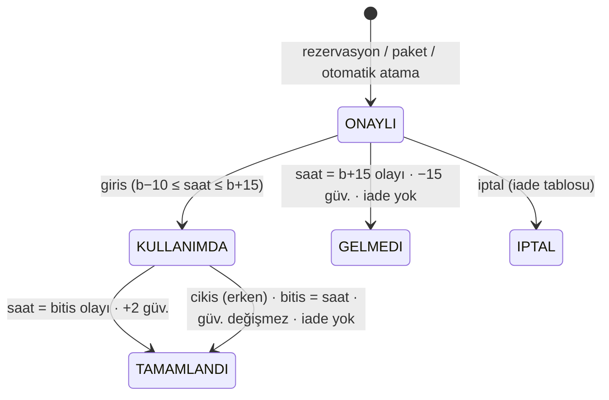

# Kampüs Kaynak Rezervasyon Sistemi — Teknik Analiz ve Uygulama Planı

> Yazılım Laboratuvarı I · 2026–2027 Güz · Proje I
> Başlangıç: **5 Ekim 2026** · Teslim: **25 Ekim 2026** (geç teslim yok)
> Bu belge, proje dokümanının **güncel sürümünün** (`Yaz_Lab_I-2.pdf`, 12 sayfa) bir senior developer gözüyle analizidir. Kodlama bu belgeye göre yapılacaktır.
> **"KARAR"** ile işaretlenen yerler dokümanın açık bıraktığı ve bizim seçtiğimiz yorumlardır. **"SORU"** ile işaretlenenleri forumda araştırma görevlilerine sormanızı öneriyoruz.

---

## İçindekiler

0. [Doküman Güncellemesiyle Gelen Değişiklikler](#0-doküman-güncellemesiyle-gelen-değişiklikler)
1. [Projenin Özü](#1-projenin-özü)
2. [Teknoloji Seçimi](#2-teknoloji-seçimi)
3. [Mimari](#3-mimari)
4. [Veri Modeli](#4-veri-modeli)
5. [Zaman Modeli](#5-zaman-modeli)
6. [Kuralların Detaylı Analizi (K1–K11 + Ekleme Kuralları)](#6-kuralların-detaylı-analizi-k1k11--ekleme-kuralları)
7. [Komut ve Sonuç Sözleşmesi](#7-komut-ve-sonuç-sözleşmesi)
8. [Modül API'si (GUI'nin çağırdığı fonksiyonlar)](#8-modül-apisi-guinin-çağırdığı-fonksiyonlar)
9. [Olay Motoru (saat komutu) Algoritması](#9-olay-motoru-saat-komutu-algoritması)
10. [Örnek Senaryonun Adım Adım İzlenmesi (19 komut)](#10-örnek-senaryonun-adım-adım-izlenmesi-19-komut)
11. [Hata Kodları Kataloğu](#11-hata-kodları-kataloğu)
12. [Masaüstü Uygulaması — Zorunlu İsterler](#12-masaüstü-uygulaması--zorunlu-isterler)
13. [Masaüstü Uygulaması — UX Tasarımı ve Ek Özellikler](#13-masaüstü-uygulaması--ux-tasarımı-ve-ek-özellikler)
14. [Proje Dizin Yapısı](#14-proje-dizin-yapısı)
15. [Çalıştırma Betikleri](#15-çalıştırma-betikleri)
16. [Test Stratejisi](#16-test-stratejisi)
17. [Belirsizlikler ve Varsayımlar](#17-belirsizlikler-ve-varsayımlar)
18. [Yol Haritası](#18-yol-haritası)
19. [Rapor Planı (IEEE, 4 sayfa)](#19-rapor-planı-ieee-4-sayfa)
20. [Demo ve Sınav Hazırlığı](#20-demo-ve-sınav-hazırlığı)
21. [Tamamlanma Kriterleri (Definition of Done)](#21-tamamlanma-kriterleri-definition-of-done)

---

## 0. Doküman Güncellemesiyle Gelen Değişiklikler

| Alan | Eski | Yeni | Etkisi |
|---|---|---|---|
| Komutlar | 9 komut | **+ `kullanici_ekle`, `kaynak_ekle`** | Yeni doğrulama sırası: `ID_MEVCUT` → `TANIMSIZ_DEGER` → `GECERSIZ_DEGER`. Başarıda ek alan yok |
| Doluluk (K5) | Türdeki kaynak sayısı | Türdeki kaynak sayısı **talep anındaki** sayıdır | Kaynak sayısı statik değil, `kaynak_ekle` ile artar |
| K3 örneği | 16:10/16:15 RED, 16:20 TAMAM | 16:15 `HAZIRLIK_IHLALI`; **başka kullanıcı** 16:30 TAMAM; **aynı kullanıcı** en erken 17:00 (K4); 16:10/16:20 `ZAMAN_ADIMI_HATASI` | Formüller değişmedi, örnek düzeltildi |
| Örnek senaryo | 15 komut | **19 komut**. İlk 4 komut u1, u2, YAZ-1, LAB-1'i ekliyor | Başlangıç dosyasında bu dördü **yok**. Örnek çıktı satırları `no:5` / `no:10` oldu |
| Kalıcılık | — | Eklenen kullanıcı/kaynak yalnızca bellekte. Başlangıç dosyası değiştirilmez. Veritabanı yok | Dosyaya geri yazma yapılmayacak |
| GUI–modül ilişkisi | Belirsizdi | GUI, modülün **ilgili fonksiyonunu** çağırır. Komut dosyası okumaz, sonuç dosyası yazmaz. 19 işlem GUI'den yapıldığında **aynı sonuçlar** görünmeli | Modülde her komut için ayrı public fonksiyon (§8) |
| GUI isterleri | 6 madde | **9 madde** + "Arayüzün değerlendirilmesi" (5 ölçüt) | §12, §13 baştan yazıldı |
| GUI davranışı | — | Arayüz geçersiz talebi **kendisi engellemez**. Her durum değişikliğinden sonra takvim, panel ve saat **otomatik** güncellenir | Buton devre dışı bırakma veya alan kısıtlama yapılmayacak (§13.5) |

> Proje klasöründeki `Yaz_Lab_I 2.pdf` **eski sürüm**. Karışıklığı önlemek için yeni PDF ile değiştirilmeli.

---

## 1. Projenin Özü

İki ayrı ürün isteniyor ama ikisi **tek bir çekirdeği** paylaşmalı:

| Bileşen | Ne yapar | Nasıl değerlendirilir |
|---|---|---|
| **Rezervasyon modülü** (çekirdek) | `baslangic.json` okur, `komutlar.jsonl` içindeki komutları sırayla işler ve her komut için bir JSON satırı üretir | **Gizli testler** ile alan alan karşılaştırılır. Eksik veya farklı alan hata sayılır, fazla alan sorun değildir |
| **Masaüstü uygulaması** | Aynı işlemleri modül fonksiyonlarını çağırarak ekrandan yaptırır | Yüz yüze demo ve **5 UX ölçütü**: işlem kolaylığı, kompaktlık, uğraştırmama, geri bildirim, görsel kalite. Doküman arayüz için "projenin ayırt edici kısmı" diyor |

**Kritik başarı faktörleri:**
1. Çekirdeğin her kuralı, öncelik sırası, yuvarlaması ve olay sıralaması **birebir** doğru olmalı (gizli testler).
2. GUI artık "olsa yeter" değil, **not ayrıştırıcı**. Özenli bir takvim ve az tıklamalı akışlar gerekiyor.
3. Bireysel proje sınavı: sorular kurallardan gelir. Sınava girmeyenin proje notu değerlendirilmez.

---

## 2. Teknoloji Seçimi

İzin verilen diller: Python ≥ 3.11, Java ≥ 17, C# (.NET ≥ 8).

### KARAR: Python 3.11+ ve PySide6 (Qt 6)

| Kriter | Gerekçe |
|---|---|
| Çekirdek bağımlılıksız | Modül **yalnızca standart kütüphaneyi** kullanır (`json`, `datetime`, `fractions`, `dataclasses`, `enum`). Gizli testler `calistir.sh` ile başka makinede çalışacağı için `pip install` gerektirmemesi büyük güvence sağlar |
| Kesin aritmetik | Ücret hesabı `fractions.Fraction` ile yapılır, böylece kayan nokta hatası oluşmaz (0,25 × 1,25 × 1,5 gibi çarpımlarda) |
| GUI kalitesi | Qt; özel çizimli takvim (`QWidget.paintEvent`), tooltip, popover, kısayol, QSS tema ve yüksek DPI desteğiyle en "profesyonel" görünümü verir. UX ölçütleri için bu önemli |
| Hız | Üç haftalık süre için en hızlı geliştirme döngüsü |

GUI'de yalnızca `PySide6` kullanılır (`requirements.txt`). Tkinter yedek seçenek olarak kalır; ancak takvim kalitesi ve 5. UX ölçütü açısından önerilmez.

---

## 3. Mimari

### 3.1 Katmanlar



### 3.2 Temel tasarım ilkeleri

1. **Her komut = bir public modül fonksiyonu.** Doküman GUI'nin "modülün ilgili fonksiyonunu çağırmasını" istiyor. `Motor.rezervasyon(...)`, `Motor.kullanici_ekle(...)` vb. her biri sonuç sözlüğü döndürür. `Motor.calistir(komut: dict)` yalnızca bir **dağıtıcıdır**: CLI bunu kullanır. Böylece iki yol aynı kodu çalıştırır.
2. **Salt okunur görünüm API'si.** Takvim; tüm durumlardaki rezervasyonları, bakımları, hazırlık şeritlerini, bekleme kayıtlarını ve simüle saati görmek ister. `sorgu kaynak` bunların hepsini vermez. Bu yüzden çekirdekte **durum değiştirmeyen** metotlar bulunur (§8.2). Hazırlık aralığı, alt satır yerleşimi ve hata açıklaması gibi değerleri **çekirdek** hesaplar. GUI yalnızca çizer.
3. **Parametre sabitlenmez.** Tür adları, roller, kotalar, ücretler, hazırlık süreleri, sertifikalar ve izinli roller başlangıç dosyasından ya da `*_ekle` komutlarından gelir. Kodda `if tur == "YAZICI"` gibi bir satır **asla** bulunmaz.
4. **Doküman sabitleri tek yerde.** 15 dk adım, 08:00–22:00, 30 dk, 60 dk, pik 10:00–16:00 / ×1,5, giriş penceresi −10/+15, güvenilirlik deltaları, iade oranları, paket 2–4 ve eşik 50 değerleri çekirdekte `sabitler.py` içinde tutulur. GUI bu dosyaya dokunmaz.
5. **Deterministik çıktı.** Bekleme listesi, olaylar ve sorgularda açık sıralama anahtarı kullanılır. ID karşılaştırmaları **sayısal** yapılır (`r2 < r10`, `b2 < b10`).
6. **stdout temizliği.** CLI çıktısı yalnızca sonuç satırlarından oluşur. Log gerekirse stderr'e yazılır.
7. **Gözlemci deseni (GUI).** Durum değiştiren her çağrıdan sonra GUI tarafındaki `Oturum` nesnesi `durum_degisti` sinyali yayar. Takvim, kullanıcı paneli ve saat göstergesi kendini yeniler (doküman bunu otomatik istiyor).

---

## 4. Veri Modeli

```python
@dataclass(frozen=True)
class KaynakTuru:
    ad: str                  # "YAZICI"
    hazirlik_dk: int
    temel_ucret: int         # saatlik KP
    enerji_yogun: bool
    sertifika: str | None

@dataclass(frozen=True)
class Rol:
    ad: str
    haftalik_kota: int
    ileri_gun: int
    azami_sure_dk: int

@dataclass(frozen=True)
class Kaynak:
    id: str
    ad: str
    tur: str
    izinli_roller: tuple[str, ...]

@dataclass
class Kullanici:
    id: str
    ad: str
    rol: str
    sertifikalar: tuple[str, ...]
    bakiye: int
    guvenilirlik: int        # 0..100, her değişimde clamp

class Durum(StrEnum):
    ONAYLI = "ONAYLI"; KULLANIMDA = "KULLANIMDA"; TAMAMLANDI = "TAMAMLANDI"
    IPTAL = "IPTAL"; GELMEDI = "GELMEDI"

@dataclass
class Rezervasyon:
    id: str                  # r1, r2, ... (otomatik atamalar dahil oluşturulma sırası)
    no: int                  # sıralama için sayısal kısım
    kullanici: str
    kaynak: str
    baslangic: datetime
    bitis: datetime          # erken çıkışta güncellenir
    ucret: int
    durum: Durum
    paket: str | None = None # p1, p2, ...

@dataclass(frozen=True)
class BakimPenceresi:
    kaynak: str
    baslangic: datetime
    bitis: datetime

@dataclass
class BeklemeKaydi:
    id: str                  # b1, b2, ...
    no: int
    kullanici: str
    kaynak: str
    baslangic: datetime
    bitis: datetime
    kayit_saati: datetime
```

**Sayaçlar:** `r`, `p` ve `b` için ayrı global sayaçlar tutulur. Reddedilen talepler sayaç tüketmez. Otomatik atamayla oluşan rezervasyon da sıradaki `r` numarasını alır (örnekte r5).

**Depo:** `saat`, `turler`, `roller`, `kaynaklar` (ekleme sırasıyla `dict`), `turdeki_kaynak_sayisi(tur)` (**dinamik**, her çağrıda güncel sayıyı verir), `bakimlar`, `kullanicilar` (ekleme sırasıyla), `rezervasyonlar` (+ kaynağa göre indeks), `bekleme`, sayaçlar.

**Kalıcılık yok:** Her şey bellekte tutulur. Başlangıç dosyası yalnızca okunur. GUI'de yeni dosya seçilince `Motor` sıfırdan kurulur.

---

## 5. Zaman Modeli

- Biçim `YYYY-AA-GGTSS:DD`. Okuma `datetime.strptime(s, "%Y-%m-%dT%H:%M")`, yazma aynı biçimde `strftime` ile yapılır (saniye yok).
- **Tüm aralıklar yarı açıktır:** `[baslangic, bitis)`.
- Kesişme koşulu: `a.b < b.e and a.e > b.b`.
- **Simüle saat herhangi bir dakika olabilir** (örnekte `11:20`). 15 dakikalık adım şartı yalnızca *taleplere* uygulanır. Erken çıkışta bitiş o anki saat olduğu için rezervasyon bitişi 15'in katı olmayabilir; bu nedenle tüm hesaplar dakika bazında yapılır.
- Saat dilimi yoktur, naive `datetime` yeterlidir. Pazartesi kontrolü `weekday() == 0` ile yapılır.

---

## 6. Kuralların Detaylı Analizi (K1–K11 + Ekleme Kuralları)

### K1 — Temel kontroller (K10 adımları 2–8)

| # | Kod | Başarısızlık koşulu | Not |
|---|---|---|---|
| 2 | `ZAMAN_ADIMI_HATASI` | `b.minute % 15 != 0` veya `e.minute % 15 != 0` veya `e <= b` | "Bitiş başlangıçtan sonra olmalıdır" → **eşitlik de hata**. 16:10 ve 16:20 burada elenir (yeni K3 örneği) |
| 3 | `GECMIS_ZAMAN` | `b < saat` | `b == saat` geçerli |
| 4 | `CALISMA_SAATI_DISI` | `b.date() != e.date()` veya `b.time() < 08:00` veya `e.time() > 22:00` | `e == 22:00` geçerli. Ertesi gün 00:00 bitiş gün aşımıdır |
| 5 | `SURE_SINIRI` | `sure < 30` veya `sure > rol.azami_sure_dk` | |
| 6 | `ILERI_TARIH_SINIRI` | `b > saat + gun × 24h`; `gun = 1 if guvenilirlik < 50 else rol.ileri_gun` | "aşamaz" → **eşitlik geçerli**. Örnek: saat 08.03 08:00, öğrenci → en geç 15.03 08:00 |
| 7 | `ROL_IZNI_YOK` | `kullanici.rol not in kaynak.izinli_roller` | |
| 8 | `SERTIFIKA_YOK` | `tur.sertifika and tur.sertifika not in kullanici.sertifikalar` | |

### K2 — Bakım (adım 9)
- Talep, aynı kaynağın herhangi bir bakım penceresiyle kesişirse `BAKIM` döner.
- **Bakımdan sonra hazırlık süresi uygulanmaz.** Bakım 10:00'da bitiyorsa 10:00 başlangıç geçerlidir.
- Bakım dolulukta sayılmaz. `kaynak_ekle` ile eklenen kaynağın bakım penceresi yoktur.

### K3 — Kesişme ve hazırlık (adım 10–11)
`h = tur.hazirlik_dk` olsun. Aynı kaynaktaki rezervasyonlar şöyle taranır:

```
# Adım 10 — önce TÜM rezervasyonlar için kesişme
for r in kaynak_rezervasyonlari if r.durum in {ONAYLI, KULLANIMDA}:
    if b < r.e and e > r.b: return KESISME
# Adım 11 — sonra TÜM rezervasyonlar için hazırlık
for r in kaynak_rezervasyonlari if r.durum in {ONAYLI, KULLANIMDA, TAMAMLANDI}:
    if b < r.e + h and e + h > r.b: return HAZIRLIK_IHLALI
```

- Kontrol **simetriktir**: yeni talep mevcut rezervasyondan *önce* olsa bile arada h kadar boşluk gerekir.
- `h = 0` olduğunda hazırlık koşulu kesişme koşuluna indirgenir (ODA 16:00 bitiş → 16:00 başlangıç geçerli).
- `GELMEDI` ve `IPTAL` **hiçbir kontrolde** sayılmaz (kesişme, hazırlık, art arda kullanım, doluluk).
- **Kural sırası önemli:** Önce tüm rezervasyonlar için kesişmeye, sonra tümü için hazırlığa bakılmalıdır. Rezervasyon bazında sırayla bakılırsa yanlış kod dönebilir.
- **Güncel örnek (YAZICI, h=20, 14:00–16:00 mevcut):**

  | Talep | Sonuç | Neden |
  |---|---|---|
  | 16:10 / 16:20 başlangıç | `ZAMAN_ADIMI_HATASI` | 15 dk adımına oturmuyor (adım 2) |
  | 16:15 başlangıç | `HAZIRLIK_IHLALI` | Hazırlık 16:20'de bitiyor |
  | 16:30, başka kullanıcı | TAMAM | |
  | 16:30 / 16:45, aynı kullanıcı | `ARDISIK_KULLANIM` | K4: en erken 17:00 |

### K4 — Art arda kullanım (adım 12)
Aynı kullanıcı ve aynı kaynak için, durumu {ONAYLI, KULLANIMDA, TAMAMLANDI} olan her rezervasyonda şuna bakılır:
`b < r.e + 60 and e + 60 > r.b` → `ARDISIK_KULLANIM`.
Örnek 10'da hem hazırlık hem art arda kullanım ihlali vardır. Sıralama gereği `HAZIRLIK_IHLALI` döner.

### K5 — Ücretlendirme (en riskli kısım)

```
toplam = Σ_{her 15 dk dilim d}  temel_ucret × 1/4 × bant_carpani(d) × pik_carpani(d)
ucret  = floor(toplam + 1/2)        # yarım yukarı yuvarlanır; Fraction ile kesin
```

- **Bantlar:** 08–10, 10–12, 12–14, 14–16, 16–18, 18–20, 20–22. Dilim, başlangıç dakikasının düştüğü banda aittir. Dilimler 15'e hizalı ve bantlar 2 saatlik olduğundan bir dilim hiçbir zaman iki banda bölünmez.
- **Doluluk (bant başına, talebin günü için):**
  ```
  dolu_dk = Σ  max(0, min(r.e, bant_bitis) − max(r.b, bant_bas))   (dakika)
            r: aynı TÜRDEKİ tüm kaynaklar, durum ∈ {ONAYLI, KULLANIMDA}, aynı gün
  doluluk = Fraction(dolu_dk, turdeki_kaynak_sayisi(talep_ani) × 120)
  ```
  - Talep edilen kaynağın kendi rezervasyonları da **dahildir** (türdeki tüm kaynaklar sayılır).
  - Talebin kendisi, bakım ve TAMAMLANDI/GELMEDI/IPTAL rezervasyonlar **dahil değildir**.
  - **YENİ:** Kaynak sayısı **talep anındaki** sayıdır. `kaynak_ekle` ile eklenen kaynak eklendiği andan itibaren sayılır; geriye dönük fiyat değişmez. Örnek: YAZ-1 eklenmeden önce YAZICI sayısı 1, eklendikten sonra 2'dir.
- **Bant çarpanı:** `1 + Fraction(floor(4 × doluluk), 4)` → 1,00 / 1,25 / 1,50 / 1,75 / 2,00. Doluluk tam 0,25 ise çarpan 1,25'tir (alt sınır dahil). `Fraction` sayesinde sınırdaki `floor` hatasız çalışır.
- **Pik çarpanı:** `tur.enerji_yogun and 10:00 <= dilim_bas < 16:00` ise 3/2, değilse 1.
- **Doluluk talep anındaki duruma göre** hesaplanır ve ücret sonradan değişmez.
- **Paket:** Her kalemin ücreti paket öncesi duruma göre hesaplanır; paketteki diğer kalemler doluluğa katılmaz.
- **Otomatik atama:** Ücret, atama anındaki doluluğa göre hesaplanır.

Doğrulama: Örnek 6'da YAZ-2 için 10–12 isteniyor. Bant 10–12'de r1'in 60 dakikası var ve 2 yazıcı bulunuyor → 60/240 = 0,25 → çarpan 1,25. `8 × 3 × 1,25 × 1,5 = 45` ✔

### K6 — Bakiye ve haftalık kota
- Ücret rezervasyon anında bakiyeden düşer. `ucret > bakiye` ise `BAKIYE_YETERSIZ` döner (eşitlik geçerli).
- **Haftalık sıfırlama:** Simüle saat bir Pazartesi 00:00'ı geçtiğinde (K11 gereği yeni saat tam 00:00 ise de) her kullanıcının bakiyesi `rol.haftalik_kota` değerine **eşitlenir**. Bu kural sonradan eklenen kullanıcılar için de geçerlidir.
- **İade:** `iade = max(0, min(hesaplanan_iade, kota − bakiye))`. Sonuçtaki `iade` alanı **gerçekte eklenen** miktardır.
- `kullanici_ekle` sırasında bakiye > kota ise `GECERSIZ_DEGER` döner. Başlangıç dosyasındaki kullanıcılar için bu kontrol yapılmaz (KARAR).

### K7 — Paket rezervasyon
Denetim sırası (ilk başarısız adım döner):

| Sıra | Kod | Koşul | `kalemler` alanı |
|---|---|---|---|
| 1 | `BULUNAMADI` | kullanıcı yok | KARAR: boş liste |
| 2 | `PAKET_BOYUTU` | kalem sayısı < 2 veya > 4 | boş liste |
| 3 | `GUVENILIRLIK_DUSUK` | güvenilirlik < 50 | boş liste |
| 4 | `PAKET_RED` | en az bir kalem K10 kontrolünden (bakiye hariç) geçemedi | **tüm** kalemler: `{sira, durum, kod?}` |
| 5 | `PAKET_ICI_KESISME` | aynı kaynaktaki iki kalem kesişiyor, hazırlığı ihlal ediyor ya da 60 dk art arda kuralını ihlal ediyor | tüm kalemler `TAMAM` |
| 6 | `BAKIYE_YETERSIZ` | toplam ücret > bakiye | tüm kalemler `TAMAM` |

- Kalem doğrulaması K10 adım 1–12 ile yapılır (kaynak yoksa kalemin kodu `BULUNAMADI` olur). Tüm kalemler **paket öncesi durumla** doğrulanır. `sira` 0'dan başlar.
- Başarı durumunda dönen alanlar: `paket_id` (p1…), `rezervasyonlar` (kalem sırasıyla), `ucretler`, `toplam`, `bakiye`. Her rezervasyonun `paket` alanı doldurulur.
- İşlem atomiktir: ya hepsi ya hiçbiri. Kalemler sonradan normal iptal kurallarıyla tek tek iptal edilebilir.
- Paket içi kesişme kontrolü, aynı kaynaktaki her kalem çifti `x, y` için: `x.b < y.e + h and x.e + h > y.b` **veya** `x.b < y.e + 60 and x.e + 60 > y.b` ise `PAKET_ICI_KESISME`.

### K8 — Durum makinesi



| Komut | Önkoşul durum | Ek kontrol | Etki |
|---|---|---|---|
| `giris` | ONAYLI | `b − 10dk ≤ saat ≤ b + 15dk`, değilse `GIRIS_PENCERESI_DISI` | → KULLANIMDA |
| `cikis` | KULLANIMDA | — | bitis = saat, → TAMAMLANDI, bekleme taraması |
| `iptal` | ONAYLI | — | → IPTAL, iade, güvenilirlik, bekleme taraması |

Hata sırası: `BULUNAMADI` → `DURUM_HATASI` → `GIRIS_PENCERESI_DISI`.

**İptal iadesi** (`kalan = b − saat`):

| Kalan süre | İade | Güvenilirlik |
|---|---|---|
| ≥ 24 saat | %100 | değişmez |
| 2 sa ≤ kalan < 24 sa | `ucret // 2` | değişmez |
| < 2 saat (negatif dahil) | 0 | −5 |

Bu tablodan sonra K6'daki kota kırpması uygulanır.

**Güvenilirlik değişimleri:** GELMEDI −15, geç iptal −5, bitiş saatinde TAMAMLANDI +2, erken çıkış 0. Her değişimde `clamp(0, 100)` uygulanır. Güvenilirlik 50'nin altındaysa ileri tarih sınırı 1 güne iner ve paket yasaklanır.

> GELMEDI olayı tam `b + 15`'te tetiklenir ve `saat` komutu yeni saatteki olayı da işler. Bu yüzden saat tam `b+15`'e alındığında rezervasyon zaten GELMEDI olmuştur ve `giris` → `DURUM_HATASI` döner. Pratikte giriş penceresi `[b−10, b+15)` gibi davranır.

### K9 — Bekleme listesi

**Kayıt açma (`bekleme` komutu):**
1. Talep K10 adım 1–12 ile doğrulanır (bakiye **hariç**).
2. Talep geçerliyse → `RED BEKLEME_GEREKSIZ`.
3. İlk hata `KESISME` veya `HAZIRLIK_IHLALI` ise → kayıt açılır (`b<n>`, `kayit_saati = saat`).
4. Başka bir hata varsa → o kodla `RED`.
5. Başarı sonucu: `bekleme_id` ve `sira` (o kaynağın sıralanmış bekleme listesindeki 1-tabanlı konum).

**Sıralama anahtarı:** `(-kullanici.guvenilirlik (güncel değer), kayit_saati, no)`.

**Tarama (yer boşaldığında: iptal, gelmeme, çıkış):**
```
def tara(kaynak_id, simdi) -> list[olay]:
    olaylar = []
    for kayit in sirali(kaynak_id):                      # sıralama tarama başında bir kez yapılır
        sonuc = dogrula(kayit, simdi, bakiye_dahil=True) # K10'un tamamı
        if sonuc.gecerli:
            r = rezervasyon_olustur(kayit, ucret=hesapla(simdi durumu))
            listeden_cikar(kayit)
            olaylar.append(OTOMATIK_ATAMA{zaman=simdi, bekleme, rezervasyon, kullanici, ucret, bakiye})
        # geçemeyen kayıt listede kalır, tarama sona kadar devam eder
    return olaylar
```
- Bir kayıt rezervasyona dönüştüğünde sonraki kayıtlar bu yeni rezervasyonu görür ve `KESISME` vb. alabilir.
- **Başlangıcı simüle saatten önceye düşen kayıtlar silinir.** KARAR: Silme sessizdir, olay üretmez. Saat her ilerlediğinde yapılır.
- `TAMAMLANDI` (doğal bitiş) yer boşaltmaz ve tarama tetiklemez.

### K10 — Doğrulama sırası
Tek bir fonksiyon kullanılır: `dogrula(kullanici_id, kaynak_id, b, e, simdi, bakiye_kontrol: bool) -> (Kod | None, ucret)`.

| Komut | Adımlar | Bakiye kontrolü |
|---|---|---|
| `rezervasyon` | 1–13 | ✔ |
| `fiyat` | 1–12, ardından ücret | ✘ |
| `paket` kalemleri | 1–12 (toplam ayrıca kontrol edilir) | ✘ |
| `bekleme` | 1–12 | ✘ |
| otomatik atama | 1–13 (o anki bakiye) | ✔ |

### K10-ek — Kullanıcı ve kaynak ekleme (YENİ)

Denetim sırası (ilk başarısız adım döner):

| Sıra | Kod | `kullanici_ekle` | `kaynak_ekle` |
|---|---|---|---|
| 1 | `ID_MEVCUT` | aynı `id` ile **kullanıcı** var | aynı `id` ile **kaynak** var |
| 2 | `TANIMSIZ_DEGER` | `rol` tanımlı değil | `tur` tanımlı değil **veya** `izinli_roller` içindeki bir rol tanımlı değil |
| 3 | `GECERSIZ_DEGER` | `bakiye < 0` veya `bakiye > rol.haftalik_kota` veya `guvenilirlik` 0–100 arasında **tam sayı** değil | denetlenmez |

- Başarıda `TAMAM` döner, ek alan yoktur.
- ID uzayları ayrıdır (KARAR): `kaynak_ekle` yalnızca kaynak ID'leriyle, `kullanici_ekle` yalnızca kullanıcı ID'leriyle çakışmaya bakar.
- "Tanımlı" ifadesi başlangıç dosyasındaki `roller` ve `kaynak_turleri` anahtarlarını kapsar (yeni rol/tür ekleme komutu yoktur).
- `sertifikalar` için kural tanımlanmamıştır, serbest liste olarak kabul edilir (KARAR). GUI ise sertifikaları başlangıç dosyasındaki değerlerden seçtirir (§12-8).
- Tip kontrolü: Python'da `bool` bir `int` alt sınıfıdır. `guvenilirlik: true` gibi bir değer `GECERSIZ_DEGER` sayılmalıdır, bu yüzden `type(x) is int` kullanılır. `bakiye` tam sayı değilse de `GECERSIZ_DEGER` döner (KARAR).
- Eklenen kaynak hemen rezerve edilebilir ve **o andan itibaren** türdeki kaynak sayısına katılır. Eklenen kullanıcı haftalık sıfırlamalara dahil olur.

### K11 — Saat ilerletme ve olay sırası
- `yeni < saat` → `RED SAAT_GERI`. `yeni == saat` → `TAMAM`, `olaylar: []`.
- `(eski, yeni]` aralığındaki **tüm** olaylar kronolojik sırayla işlenir.
- Aynı anda birden fazla olay varsa sıra şöyledir: 1) `HAFTALIK_SIFIRLAMA` 2) `TAMAMLANDI` (r-no artan) 3) `GELMEDI` (r-no artan) 4) boşalan her kaynak için bekleme taraması (GELMEDI sırasıyla).
- Algoritma §9'da.

---

## 7. Komut ve Sonuç Sözleşmesi

Her sonuç satırı `{"no": <1'den başlayan sıra>, "komut": "<ad>", "durum": "TAMAM" | "RED", ...}` biçimindedir; RED satırlarında `kod` bulunur. Satırlar `ensure_ascii=False` ile tek satır olarak yazılır; alan sırası önemsizdir.

| Komut | Girdi alanları | TAMAM ek alanları |
|---|---|---|
| `saat` | `zaman` | `olaylar: [{zaman, tur, ...}]` |
| `rezervasyon` | `kullanici, kaynak, baslangic, bitis` | `rezervasyon_id, ucret, bakiye` |
| `paket` | `kullanici, kalemler: [{kaynak, baslangic, bitis}]` | `paket_id, rezervasyonlar, ucretler, toplam, bakiye` |
| `fiyat` | rezervasyon ile aynı | `ucret` |
| `iptal` | `rezervasyon` | `iade, bakiye, guvenilirlik, olaylar` |
| `giris` | `rezervasyon` | `yeni_durum` |
| `cikis` | `rezervasyon` | `yeni_durum, guvenilirlik, olaylar` |
| `bekleme` | `kullanici, kaynak, baslangic, bitis` | `bekleme_id, sira` |
| `sorgu` (kullanici) | `tur:"kullanici", id` | `bakiye, guvenilirlik, rezervasyonlar: [{id, kaynak, baslangic, bitis, durum, ucret}]` |
| `sorgu` (kaynak) | `tur:"kaynak", id, gun` | `doluluk: [{baslangic, bitis, tur, rezervasyon?}]` |
| **`kullanici_ekle`** | `id, ad, rol, sertifikalar, bakiye, guvenilirlik` | — |
| **`kaynak_ekle`** | `id, ad, tur, izinli_roller` | — |

**Olay biçimleri:**
```json
{"zaman":"2027-03-08T10:15","tur":"GELMEDI","rezervasyon":"r2","kullanici":"u2","guvenilirlik":65}
{"zaman":"2027-03-08T13:00","tur":"TAMAMLANDI","rezervasyon":"r7","kullanici":"u1","guvenilirlik":82}
{"zaman":"2027-03-08T11:15","tur":"OTOMATIK_ATAMA","bekleme":"b1","rezervasyon":"r5","kullanici":"u2","ucret":18,"bakiye":57}
{"zaman":"2027-03-15T00:00","tur":"HAFTALIK_SIFIRLAMA"}
```
`iptal` ve `cikis` sonuçlarındaki OTOMATIK_ATAMA olaylarına da `zaman` ve `tur` alanları eklenir (fazla alan hata sayılmaz).

**Sorgu ayrıntıları:**
- `sorgu kullanici`: **Tüm durumlar** listelenir (örnekte GELMEDI de var). Sıralama `(baslangic, no)` ile yapılır. `bitis` güncel değerdir.
- `sorgu kaynak`: Yalnızca ONAYLI ve KULLANIMDA rezervasyonlar ile o günle kesişen bakım pencereleri listelenir; `baslangic`'a göre sıralanır (eşitlikte KARAR: önce BAKIM, sonra rezervasyon no). `tur` değeri `"REZERVASYON"` veya `"BAKIM"`dır; `rezervasyon` alanı yalnızca REZERVASYON satırlarında bulunur.
- Kullanıcı, kaynak veya rezervasyon yoksa `RED BULUNAMADI` döner.

**Örnek çıktılar:**
```json
{"no":1,"komut":"kullanici_ekle","durum":"TAMAM"}
{"no":5,"komut":"rezervasyon","durum":"TAMAM","rezervasyon_id":"r1","ucret":36,"bakiye":84}
{"no":10,"komut":"rezervasyon","durum":"RED","kod":"HAZIRLIK_IHLALI"}
{"no":12,"komut":"paket","durum":"TAMAM","paket_id":"p1","rezervasyonlar":["r3","r4"],"ucretler":[48,8],"toplam":56,"bakiye":244}
{"no":7,"komut":"paket","durum":"RED","kod":"PAKET_RED","kalemler":[{"sira":0,"durum":"TAMAM"},{"sira":1,"durum":"RED","kod":"SERTIFIKA_YOK"}]}
```

**Bozuk girdi (KARAR):** Bilinmeyen komut veya eksik alan için `RED` + `kod: "GECERSIZ_KOMUT"` döner. Program **asla çökmez** ve her satır için bir çıktı üretir. Boş satırlar atlanır ve sayaca dahil edilmez.

---

## 8. Modül API'si (GUI'nin çağırdığı fonksiyonlar)

### 8.1 Komut fonksiyonları (durum değiştirebilir)

```python
class Motor:
    @classmethod
    def dosyadan(cls, yol: str) -> "Motor": ...

    # Her fonksiyon, Bölüm 5'teki sonuç sözlüğünü ("no" hariç) döndürür.
    def saat(self, zaman: str) -> dict
    def rezervasyon(self, kullanici, kaynak, baslangic, bitis) -> dict
    def paket(self, kullanici, kalemler: list[dict]) -> dict
    def fiyat(self, kullanici, kaynak, baslangic, bitis) -> dict
    def iptal(self, rezervasyon) -> dict
    def giris(self, rezervasyon) -> dict
    def cikis(self, rezervasyon) -> dict
    def bekleme(self, kullanici, kaynak, baslangic, bitis) -> dict
    def sorgu_kullanici(self, id) -> dict
    def sorgu_kaynak(self, id, gun) -> dict
    def kullanici_ekle(self, id, ad, rol, sertifikalar, bakiye, guvenilirlik) -> dict
    def kaynak_ekle(self, id, ad, tur, izinli_roller) -> dict

    def calistir(self, komut: dict) -> dict   # dağıtıcı: CLI için
```

### 8.2 Görünüm API'si (salt okunur, GUI için)

| Metot | Döndürdüğü | Kullanıldığı yer |
|---|---|---|
| `simdi()` | simüle saat | Üst bar, takvimdeki "şimdi" çizgisi |
| `parametreler()` | türler, roller, sertifika havuzu (türlerdeki sertifikalar ∪ kullanıcılardakiler) | Ekleme formlarındaki seçimler |
| `kullanicilar()` / `kaynaklar()` | listeler (ekleme sırasıyla) | Seçiciler, takvim satırları |
| `gun_gorunumu(gun)` | kaynak başına: rezervasyonlar (**tüm durumlar**, `alt_satir` indeksiyle), bakımlar, hazırlık şeritleri, bekleme kayıtları | Takvim |
| `rezervasyon_detayi(id)` | numara, kullanıcı, aralık, ücret, durum, paket | Takvim popover'ı |
| `kullanici_bekleme_kayitlari(id)` | kayıtlar ve güncel sıra numaraları | Kullanıcı paneli |
| `hata_aciklamasi(kod)` | Türkçe açıklama | Tüm geri bildirimler |
| `sonraki_olay_zamani()` | bir sonraki GELMEDI/TAMAMLANDI/sıfırlama anı | "Sonraki olaya git" düğmesi (§13) |
| `iptal_onizleme(id)` | iade ve güvenilirlik etkisi (durum değiştirmez) | İptal düğmesinin yanındaki bilgi (§13) |

**Alt satır (lane) yerleşimi** çekirdekte hesaplanır, çünkü hangi durumların çakışabileceği bir kural bilgisidir. Önce aktif rezervasyonlar (ONAYLI/KULLANIMDA/TAMAMLANDI) 0. satıra yerleştirilir; bunlar birbiriyle çakışamaz. IPTAL/GELMEDI olanlar ise greedy aralık bölümleme ile çakışmadıkları ilk alt satıra yerleştirilir.

---

## 9. Olay Motoru (saat komutu) Algoritması

Otomatik atamalar yeni rezervasyonlar yaratır ve bunların GELMEDI zamanı hâlâ ilerletilen aralığın içinde kalabilir. Ayrıca haftalık sıfırlama, sonraki atamaların bakiye kontrolünü etkiler. Bu yüzden olaylar **önceden listelenmez**; her adımda bir sonraki olay zamanı dinamik olarak bulunur:

```python
def saat(self, yeni):
    if yeni < self.saat: return RED("SAAT_GERI")
    olaylar = []
    while True:
        t = self.sonraki_olay_zamani(sonra=self.saat)   # > self.saat
        if t is None or t > yeni: break
        self.saat = t
        self.bekleme_temizle()                           # baslangic < t olanlar silinir

        if t.weekday() == 0 and t.time() == time(0, 0):
            for u in kullanicilar: u.bakiye = rol(u).haftalik_kota
            olaylar.append(HAFTALIK_SIFIRLAMA(t))

        for r in sorted(KULLANIMDA ve r.bitis == t, key=no):
            r.durum = TAMAMLANDI; guv(r.kullanici, +2)
            olaylar.append(TAMAMLANDI(...))

        bosalan = []                                      # sıralı, tekrarsız
        for r in sorted(ONAYLI ve r.baslangic + 15dk == t, key=no):
            r.durum = GELMEDI; guv(r.kullanici, -15)
            olaylar.append(GELMEDI(...))
            if r.kaynak not in bosalan: bosalan.append(r.kaynak)

        for k in bosalan:
            olaylar += self.tara(k, simdi=t)
    self.saat = yeni
    self.bekleme_temizle()
    return TAMAM(olaylar=olaylar)
```

- Bir olay işlenirken `self.saat = t` yapılır. Böylece otomatik atama K10'u "o anki saat" ile denetler.
- Otomatik atamayla oluşan rezervasyon `b ≥ t` olduğundan olayları `> t` olur; döngü bunları sonraki turda yakalar.
- Uzun ilerletmelerde birden fazla Pazartesi geçilebilir; her biri ayrı bir olaydır.

---

## 10. Örnek Senaryonun Adım Adım İzlenmesi (19 komut)

Başlangıç: **2027-03-08 Pazartesi 08:00**. Başlangıç dosyasında **u1, u2, YAZ-1 ve LAB-1 yoktur**; ilk dört komut bunları ekler. Bu tablo kabul testimizin gerekçesidir.

| No | Komut | Beklenen | Kontrol edilen kural / hesap |
|---|---|---|---|
| 1 | kullanici_ekle u1 (OGRENCI, bakiye 120, güv. 80) | TAMAM | rol tanımlı, 120 ≤ kota 120 |
| 2 | kullanici_ekle u2 (aynı değerler) | TAMAM | |
| 3 | kaynak_ekle YAZ-1 (YAZICI, [OGRENCI]) | TAMAM | YAZICI kaynak sayısı **1 → 2** |
| 4 | kaynak_ekle LAB-1 (LAB, 3 rol) | TAMAM | tür ve roller tanımlı |
| 5 | rez u1 YAZ-1 11–13 | TAMAM r1, 36, bakiye 84 | 8 dilim × 3 × 1,0 × 1,5 (pik) |
| 6 | rez u2 YAZ-2 10–12 | TAMAM r2, 45, bakiye 75 | Bakım 08–10 sonrası hazırlık yok; doluluk 60/(**2**×120) = 0,25 → 1,25 |
| 7 | rez u2 YAZ-2 12:30–13:30 | RED ARDISIK_KULLANIM | Hazırlık 12:20'de bitiyor; boşluk 30 dk < 60 dk |
| 8 | rez u2 LAB-1 14–15 | RED SERTIFIKA_YOK | LAB_GUVENLIK yok |
| 9 | rez u1 YAZ-1 13:10–14 | RED ZAMAN_ADIMI_HATASI | 13:10 adıma oturmuyor |
| 10 | rez u1 YAZ-1 13:15–14 | RED HAZIRLIK_IHLALI | 13:20 gerekiyor; ARDISIK'tan önce kontrol edilir |
| 11 | fiyat u3 CIH-1 14–16 | TAMAM 48 | 8 × 4 × 1,0 × 1,5; durum ve r sayacı değişmez |
| 12 | paket u3 CIH-1 14–16 + ODA-1 14–16 | TAMAM p1 [r3,r4] [48,8] 56, bakiye 244 | ODA enerji yoğun değil |
| 13 | rez u1 CIH-1 16:30–17:30 | RED ROL_IZNI_YOK | rol, sertifikadan önce kontrol edilir |
| 14 | rez u1 ODA-2 16 Mart 09–10 | RED ILERI_TARIH_SINIRI | sınır 15.03 08:00 |
| 15 | bekleme u2 YAZ-1 12–13 | TAMAM b1, sıra 1 | r1 ile KESISME |
| 16 | saat 11:20 | TAMAM, 3 olay | 10:15 r2 GELMEDI (u2 → 65); 11:15 r1 GELMEDI (u1 → 65); 11:15 OTOMATIK_ATAMA b1→r5, ücret 18, u2 bakiye 57 |
| 17 | giris r1 | RED DURUM_HATASI | r1 GELMEDI durumunda |
| 18 | iptal r4 | TAMAM iade 4, bakiye 248, güv. 80, olaylar [] | 2 sa 40 dk kala → %50; 248 ≤ 300 |
| 19 | sorgu kullanici u2 | bakiye 57, güv. 65, [r2 GELMEDI 45, r5 ONAYLI 18] | tüm durumlar, başlangıca göre sıralı |

**Dikkat:** 3. adım atlanırsa ya da kaynak sayısı başlangıç dosyasından bir kez sabitlenirse YAZICI sayısı 1 kalır. Bu durumda 6. adımda doluluk 60/120 = 0,5 → 1,50 ve ücret 54 olur; test kalır. Kaynak sayısı **her talepte yeniden** hesaplanmalıdır.

**Doküman şartı:** Bu 19 işlem GUI'den aynı sırayla yapıldığında ekranda aynı sonuçlar görülmelidir (§16'da otomatik test olarak da eklenecek).

---

## 11. Hata Kodları Kataloğu

Kod → Türkçe açıklama sözlüğü çekirdekteki `hata_kodlari.py` içinde tutulur. GUI red durumunda **kod + açıklama + (varsa) öneri** gösterir.

| Kod | Kaynak | Açıklama (GUI metni) |
|---|---|---|
| `BULUNAMADI` | K10/K7/K8/sorgu | Kullanıcı, kaynak veya rezervasyon bulunamadı |
| `ZAMAN_ADIMI_HATASI` | K1 | Saatler 15 dakikalık adımlara oturmalı ve bitiş başlangıçtan sonra olmalı |
| `GECMIS_ZAMAN` | K1 | Başlangıç simüle saatten önce olamaz |
| `CALISMA_SAATI_DISI` | K1 | Rezervasyon aynı gün 08:00–22:00 arasında olmalı |
| `SURE_SINIRI` | K1 | Süre 30 dk ile rolün azami süresi arasında olmalı |
| `ILERI_TARIH_SINIRI` | K1 | Rolün ileri tarih sınırı aşıldı (güvenilirlik 50'nin altındaysa 1 gün) |
| `ROL_IZNI_YOK` | K1 | Rolünüz bu kaynağı rezerve edemez |
| `SERTIFIKA_YOK` | K1 | Bu kaynak türü için gerekli sertifika yok |
| `BAKIM` | K2 | Kaynak bu aralıkta bakımda |
| `KESISME` | K3 | Aralık başka bir rezervasyonla çakışıyor |
| `HAZIRLIK_IHLALI` | K3 | Kaynağın hazırlık (soğuma/havalandırma) süresi ihlal ediliyor |
| `ARDISIK_KULLANIM` | K4 | Aynı kaynaktaki rezervasyonlarınız arasında en az 60 dk olmalı |
| `BAKIYE_YETERSIZ` | K6/K7 | Bakiye yetersiz |
| `PAKET_BOYUTU` | K7 | Paket 2–4 kalemden oluşmalı |
| `GUVENILIRLIK_DUSUK` | K7 | Güvenilirlik 50'nin altında olduğu için paket yapılamaz |
| `PAKET_RED` | K7 | Paketteki en az bir kalem geçersiz |
| `PAKET_ICI_KESISME` | K7 | Paketteki kalemler birbiriyle çakışıyor |
| `DURUM_HATASI` | K8 | Rezervasyon bu işlem için uygun durumda değil |
| `GIRIS_PENCERESI_DISI` | K8 | Giriş, başlangıçtan 10 dk önce ile 15 dk sonra arasında yapılabilir |
| `SAAT_GERI` | K11 | Saat geri alınamaz |
| `BEKLEME_GEREKSIZ` | K9 | Talep zaten geçerli; doğrudan rezervasyon yapabilirsiniz |
| **`ID_MEVCUT`** | Ekleme | Bu kimlikle bir kayıt zaten var |
| **`TANIMSIZ_DEGER`** | Ekleme | Rol, tür veya izinli rol başlangıç dosyasında tanımlı değil |
| **`GECERSIZ_DEGER`** | Ekleme | Bakiye 0 ile rol kotası arasında, güvenilirlik 0–100 arasında tam sayı olmalı |
| `GECERSIZ_KOMUT` | (bizim) | Komut biçimi geçersiz |

---

## 12. Masaüstü Uygulaması — Zorunlu İsterler

### 12.1 Modül–arayüz ilişkisi (dokümandaki şartlar)
- Uygulama açılırken bir başlangıç dosyası seçilir ve modüle yüklenir.
- Her ekran işlemi, **modülün ilgili fonksiyonunu** çağırarak yapılır (§8.1).
- Uygulama komut dosyası **okumaz**, sonuç dosyası **yazmaz**. Veriler yalnızca bellekte tutulur, veritabanı yoktur.
- Arayüzde iş kuralı bulunmaz. **Arayüz bir talebi kendisi engellemez**; geçersiz talep de gönderilebilir, reddi ve kodunu modül verir.
- Durum değiştiren her işlemden sonra takvim, kullanıcı paneli ve simüle saat **kullanıcı bir şey yapmadan** güncellenir.
- Başlangıç dosyasındaki bir parametre değiştiğinde uygulama kod değişikliği olmadan yeni kurala göre davranmalıdır (demoda denetlenecek).

### 12.2 Dokuz ister → bileşen eşlemesi

| # | İster | Kritik alt şartlar | Bileşen / çözüm |
|---|---|---|---|
| 1 | **Başlangıç dosyası seçimi** | Açılışta seçilebilmeli. Yeni dosyada tüm durum yeniden kurulmalı | Açılış ekranı ("Dosya seç" + son kullanılanlar). Üst barda "Dosya değiştir" düğmesi → `Motor.dosyadan()` ile sıfırdan kurulum, günlük temizlenir |
| 2 | **Kaynak takvimi** | Satır = kaynak, x ekseni 08–22. Duruma göre renkli kutular. Bakım ve hazırlık ayrı görünümde. **Gün değiştirilebilmeli.** **15 dk adımlar ayırt edilebilmeli.** **Simüle saatin konumu görülmeli.** **IPTAL/GELMEDI ile yeni rezervasyon çakışırsa alt satırda üst üste binmeden** gösterilmeli. **Ayrıntılar** (numara, kullanıcı, aralık, ücret, durum, paket) takvimden erişilebilir olmalı | Özel çizimli `TakvimWidget`: saat çizgileri koyu, 15 dk çizgileri açık. Kırmızı "şimdi" çizgisi. Geçmiş bölge hafif soluk. Alt satırlar çekirdekten gelir. Hover'da tooltip, tıklamada popover |
| 3 | **Talep formu** | Tek ve paket talebi. Göndermeden önce `fiyat` ile ücret. Red → kod + Türkçe açıklama. Kabul → rezervasyon no, ücret, yeni bakiye. `PAKET_RED` → **her kalemin kendi satırında** geçti/neden reddedildi | Form paneli; paket modunda kalem tablosu ve her satırda durum ikonu ile kod. Sonuç kartı formun hemen altında |
| 4 | **Kullanıcı paneli** | Bakiye, güvenilirlik, rezervasyonlar, bekleme kayıtları. Listeden seçim. Oturum açma **yok** | Sol panel. Üstte kullanıcı seçici, altında KPI'lar ve listeler |
| 5 | **Eylemler** | Giriş/çıkış/iptal **rezervasyonun göründüğü yerden** yapılmalı; **ID yazılmamalı**. Sonuçta iade, bakiye, güvenilirlik ve OTOMATIK_ATAMA gösterilmeli. `KESISME`/`HAZIRLIK_IHLALI` reddinde **bekleme seçeneği** sunulmalı; **bilgiler yeniden girilmemeli** | Takvim kutusu popover'ında ve kullanıcı panelindeki satırda eylem düğmeleri. Red kartında "Bekleme listesine ekle" düğmesi aynı talebi gönderir |
| 6 | **Simüle saat denetimi** | İleri alınabilmeli, oluşan olaylar listelenmeli. **Saat her zaman görünür olmalı** | Üst barda sabit saat göstergesi ve hızlı düğmeler. Olaylar açılır bir listede gösterilir |
| 7 | **Olay günlüğü** | Tüm sonuçlar sırayla listelenmeli. Seçilen satırda **komut karşılığı ve sonuç**, Bölüm 5 JSON biçiminde görülebilmeli | Alt panel: satır listesi + seçilen satır için iki JSON görünümü (komut / sonuç) |
| 8 | **Yeni üye ekleme** | `kullanici_ekle` çağrılır. Rol ve sertifikalar **başlangıç dosyasındaki değerlerden seçilir**. Red → kod + açıklama. Eklenen kullanıcı **hemen** listede görünmeli | Küçük açılır panel: rol açılır liste, sertifikalar çoklu seçim çipleri, bakiye için rol kotası varsayılanı |
| 9 | **Yeni kaynak ekleme** | `kaynak_ekle` çağrılır. Tür ve izinli roller **seçilir**. Red → kod + açıklama. Eklenen kaynak **hemen** takvimde görünmeli | Takvimin altında "+ Kaynak" satırı → satır içi form |

### 12.3 "Arayüz engellemez" ilkesinin pratik sonuçları
- Eylem düğmeleri (Giriş/Çıkış/İptal) duruma göre **devre dışı bırakılmaz**. Durum uygun değilse modül `DURUM_HATASI` döndürür ve bu düğmenin yanında gösterilir. Düğmeyi devre dışı bırakmak, GUI'nin K8 kuralını bilmesi anlamına gelir. Görsel vurgu olarak yalnızca durum etiketi gösterilir.
- Saat alanları **düzenlenebilir açılır listedir**. 15 dakikalık seçenekler sunulur ama `13:10` gibi serbest değer de yazılabilir; böylece `ZAMAN_ADIMI_HATASI` demoda gösterilebilir.
- Tarih seçicide aralık kısıtı **yoktur** (geçmiş tarih veya ileri tarih sınırının ötesi seçilebilir).
- Ekleme formlarında bakiye ve güvenilirlik **alt/üst sınırsız** sayı alanlarıdır. `-5` veya `150` girilebilir ve modül `GECERSIZ_DEGER` döndürür.
- Seçim listeleri (kullanıcı, kaynak, rol, tür) "uğraştırmama" ölçütü gereği kullanılır. Bu bir engelleme değildir; değerler başlangıç dosyasından gelir.

---

## 13. Masaüstü Uygulaması — UX Tasarımı ve Ek Özellikler

Doküman beş ölçüt veriyor: **işlem kolaylığı, kompaktlık, uğraştırmama, geri bildirim, görsel kalite.** Aşağıdaki tasarım her ölçüte doğrudan cevap verecek şekilde kuruldu. Tasarım kararları raporun "Tasarım kararları" bölümünde gerekçelendirilmeli; bu tablo raporda o bölümün iskeleti olarak kullanılabilir.

### 13.1 Ekran düzeni — tek pencere, sekme ve diyalog yok

```
┌───────────────────────────────────────────────────────────────────────────────────────────┐
│ ◆ Kampüs Rezervasyon   baslangic.json [Değiştir]      🕐 Pzt 08.03.2027 11:20             │
│                         [+15dk] [+1sa] [+1gün] [⏭ Sonraki olay] [Saate git…]  [↶ Geri al] │
├──────────────────────┬────────────────────────────────────────────────────────────────────┤
│ 👤 [u2 · Mehmet ▾][+]│  ◀  Pzt 08 Mart 2027  ▶  [Bugün]        Filtre: [Tümü ▾] [Yalnız u2]│
│ OGRENCI              │        08    09    10    11  │ 12    13    14    15    16 ... 22     │
│ ┌──────┐ ┌──────┐    │ YAZICI ───────────────────── │ ───────────────────────────────────  │
│ │ 57 KP│ │ 65 ▼ │    │ YAZ-2  ▧▧BAKIM▧▧[ r2 ·u2   ]│                                       │
│ │/120  │ │güven.│    │                 └GELMEDI─┘  │                                       │
│ └──────┘ └──────┘    │ YAZ-1               [r1 GELMEDI ]                                    │
│ Rezervasyonlar       │                          │  [r5 ONAYLI]░hz░                          │
│  r2 YAZ-2 10–12 GELMEDI   ╎ (alt satır: iptal/gelmedi ile çakışan yeni rezervasyon)       │
│  r5 YAZ-1 12–13 ONAYLI [Giriş][İptal]│ CIHAZ ─────────────────────────────────────────────│
│ Bekleme kayıtları    │ CIH-1                        │      [ r3 · u3 · p1 ]░hz░           │
│  —                   │ ODA ──────────────────────────────────────────────────────────────  │
│                      │ ODA-1                        │      [ r4 IPTAL ]                   │
│                      │ [+ Kaynak ekle]              │ (kırmızı çizgi = simüle saat)       │
│                      ├────────────────────────────────────────────────────────────────────┤
│                      │ TALEP  (•)Tek ( )Paket   Kaynak[YAZ-1▾] Gün[08.03▾] [12:00▾]–[13:00▾]│
│                      │ Ücret: 18 KP  → bakiye 57 → 39      [Rezerve et ⏎]                  │
│                      │ ✖ KESISME — Aralık başka bir rezervasyonla çakışıyor  [Bekleme listesine ekle] │
├──────────────────────┴────────────────────────────────────────────────────────────────────┤
│ GÜNLÜK  [Tümü|TAMAM|RED] 🔍____   #16 saat TAMAM 3 olay │ Komut {…}  │ Sonuç {…}  [Kopyala] │
└───────────────────────────────────────────────────────────────────────────────────────────┘
```

### 13.2 Ölçüt bazında tasarım kararları

| Ölçüt | Tasarım kararı |
|---|---|
| **İşlem kolaylığı** (az adım, ekranlar arası gidip gelme yok) | Tek pencere: takvim, form, panel ve günlük aynı anda görünür. **Takvimde boş alana sürükle-bırak** formu doldurur (kaynak, gün, başlangıç-bitiş 15 dk'ya yapışır). Kutuya tıklayınca açılan popover'da Giriş/Çıkış/İptal düğmeleri bulunur. Bir rezervasyon tek sürükleme ve tek tıklamayla yapılır |
| **Kompaktlık** | Diyalog penceresi yok; ekleme formları satır içinde/açılır panel olarak açılır. Yoğun günde satır yüksekliği otomatik küçülür. Takvim, 1366×768 ekranda yatay kaydırma olmadan 08–22 aralığını sığdırır |
| **Uğraştırmama** (değerler seçilir, varsayılanlar anlamlı, gereksiz onay yok) | Form varsayılanları: seçili kullanıcı, takvimde görüntülenen gün, simüle saatten sonraki ilk 15 dk adımı, 1 saat süre. İptalde onay penceresi yerine düğme üzerinde iade önizlemesi gösterilir ("İptal · %50 iade: 4 KP"), çünkü bilgi onaydan iyidir. Yeni üye eklemede bakiye varsayılanı rol kotası, güvenilirlik varsayılanı 100'dür. Son seçilen kaynak hatırlanır |
| **Geri bildirim** (sonuç işlemin yanında) | Form sonucu formun altında kart olarak gösterilir. Eylem sonucu popover'ın içinde görünür (iade, bakiye, güvenilirlik değişimi ve OTOMATIK_ATAMA olayları). Saat ilerletme sonucu saat düğmelerinin altında olay listesi olarak açılır. Değişen takvim kutuları 1,5 sn vurgulanır. Bakiye/güvenilirlik değişince KPI'da `−18` gibi bir delta animasyonu görünür |
| **Görsel kalite** | 8 px ızgara, tek yazı tipi ailesi (Inter veya sistem fontu). Durum renkleri tutarlı ve renk körlüğüne uygun; durum ayrıca ikon ve desenle de kodlanır (aşağıda). Kaynaklar türe göre gruplanır ve tür başlıkları gösterilir. Kutu metni sığmazsa kademeli kısalır: "r5 · u2 · 18 KP" → "r5" → yalnız renk |

### 13.3 Takvim görsel dili

| Öğe | Görünüm |
|---|---|
| ONAYLI | Dolu mavi kutu, beyaz metin |
| KULLANIMDA | Dolu yeşil kutu + ▶ ikonu |
| TAMAMLANDI | Gri kutu, soluk metin, ✓ |
| IPTAL | Şeffaf kutu, kırmızı **kesikli** kenar, üstü çizili metin, **alt satırda** |
| GELMEDI | Turuncu çapraz tarama, ✕, **alt satırda** |
| Bakım | Koyu gri çapraz desen, "BAKIM" etiketi |
| Hazırlık | Rezervasyonun bitişinden sonra `h` dk boyunca açık sarı ince tarama (genişliği çekirdekten gelir) |
| Bekleme kaydı | Noktalı çerçeveli "hayalet" kutu, `b1 · sıra 1` etiketi (gizlenebilir) |
| Simüle saat | Kırmızı dikey çizgi + üstte küçük saat etiketi. Geçmiş bölge %5 karartılmış |
| 15 dk adımlar | Saat çizgileri belirgin, çeyrek çizgiler çok açık; hover'da imleç altındaki 15 dk hücresi vurgulanır |
| Pik saatler | 10:00–16:00 başlık bölgesinde ince turuncu bant (bilgi amaçlı; değer `sabitler`'den görünüm API'siyle gelir) |

Paket rezervasyonları aynı paketin kutuları arasında ortak bir kenar rengi veya `p1` rozeti taşır; hover'da paketin diğer kalemleri vurgulanır.

### 13.4 Önerilen ek özellikler (UX'i geliştiren, kuralları ihlal etmeyen)

Öncelik: **P1** = mutlaka yapalım (ölçütlere doğrudan etki eder), **P2** = vakit kalırsa, **P3** = bonus.

| Öncelik | Özellik | Açıklama | Neden kural ihlali değil |
|---|---|---|---|
| P1 | **Takvimde sürükleyerek talep** | Boş alana sürüklenen aralık formu doldurur ve fiyat önizlemesi anında gelir | Yalnızca form alanını doldurur; doğrulamayı modül yapar |
| P1 | **Canlı fiyat önizlemesi** | Form alanı her değiştiğinde (200 ms gecikmeyle) `fiyat` çağrılır. Geçersizse kod önceden gösterilir; gönder düğmesi **yine de aktif kalır** | `fiyat` modül fonksiyonu; engelleme yok |
| P1 | **Tek tıkla bekleme** | KESISME/HAZIRLIK_IHLALI red kartında "Bekleme listesine ekle" düğmesi aynı parametrelerle `bekleme` çağırır ve sonucu (`b3 · sıra 2`) yerinde gösterir | Doküman zorunlu kılıyor |
| P1 | **Kullanıcı filtresi / vurgusu** | "Yalnız seçili kullanıcı" anahtarı diğer kullanıcıların kutularını soluklaştırır | Saf görünüm |
| P1 | **Klavye kısayolları** | `Ctrl+Enter` gönder, `←/→` gün değiştir, `T` bugün, `+` saat +15 dk, `Ctrl+Z` geri al, `Ctrl+F` günlükte ara, `Esc` popover kapat | — |
| P1 | **Saat düğmeleri ve "Sonraki olaya git"** | +15 dk / +1 sa / +1 gün düğmeleri. "Sonraki olay" bir sonraki GELMEDI/TAMAMLANDI/sıfırlama anına atlar, bu da demoda zaman kazandırır | Olay zamanı `sonraki_olay_zamani()` ile **modülden** gelir |
| P2 | **Geri al (Undo)** | Modül deterministik olduğu için geri alma, başlangıç dosyasından yeniden kurup son durum değiştiren işlem hariç tüm çağrıları tekrar oynatarak yapılır. Demoda hatalı tıklamayı kurtarır ve "deneme" yapmayı kolaylaştırır | Modüle dokunmaz, aynı fonksiyonları yeniden çağırır |
| P2 | **İptal iade önizlemesi** | İptal düğmesinde "%50 · 4 KP iade" ya da "%0 · güvenilirlik −5" yazar | `iptal_onizleme()` modülde hesaplanır |
| P2 | **Olay vurgusu** | Saat ilerletilince GELMEDI/TAMAMLANDI/OTOMATIK_ATAMA olan kutular kısa süre parlar; olay listesinde bir olaya tıklanınca takvim o güne ve kutuya gider | Saf görünüm |
| P2 | **Günlük filtre ve arama** | TAMAM/RED filtresi, metin araması, "JSON'u kopyala" düğmesi | Dosya yazmaz, panoya kopyalar |
| P2 | **Doluluk ısı şeridi** | Her tür grubunun başlığında bantların doluluk oranı ince bir ısı şeridiyle gösterilir. Kullanıcı ucuz saatleri görsel olarak bulur | Doluluk değerleri görünüm API'siyle **modülden** gelir |
| P3 | **Açık/koyu tema** | QSS ile iki tema, sistem temasını takip eder | — |
| P3 | **Yakınlaştırma** | `Ctrl+kaydırma` ile saat genişliği değişir; yoğun günlerde 15 dk hücreleri büyür | — |
| P3 | **Boş durum metinleri** | "Bu gün için rezervasyon yok — takvimde bir aralık sürükleyin" gibi yönlendirici metinler | — |

**Bilinçli olarak yapılmayanlar:**
- Kalıcı kayıt ve dosyaya dışa aktarma: Doküman "sonuç dosyası yazmaz" diyor; panoya kopyalama yeterli.
- Kurala göre devre dışı düğmeler ve tarih kısıtları (bkz. §12.3).
- Onay pencereleri: Ölçüt 3'e aykırı. Yerine önizleme ve geri alma kullanılır.

### 13.5 GUI iç mimarisi

```
arayuz/
  oturum.py          # Motor'u sarar: her çağrıda (komut_dict, sonuc_dict) günlüğe eklenir,
                     # durum değiştirenlerden sonra durum_degisti sinyali yayılır; undo için çağrı geçmişi tutulur
  ana_pencere.py     # yerleşim, kısayollar
  ust_bar.py         # dosya, simüle saat, saat düğmeleri, geri al
  takvim/
    takvim_widget.py # paintEvent, hit-test, sürükleme
    popover.py       # rezervasyon detayı + eylemler
  talep_formu.py     # tek/paket, canlı fiyat, sonuç kartı, bekleme düğmesi
  kullanici_paneli.py
  ekleme_panelleri.py # kullanıcı/kaynak ekleme
  olay_gunlugu.py
  tema.py            # renkler, yazı tipleri, QSS (durum → renk eşlemesi)
```

`Oturum`, komut sözlüğünü günlük gösterimi için oluşturur (Bölüm 5 biçimi). Bunun dışında hiçbir hesap yapmaz.

---

## 14. Proje Dizin Yapısı

```
yazlab/
├── calistir.sh                 # ./calistir.sh baslangic.json komutlar.jsonl > sonuclar.jsonl
├── calistir.bat
├── arayuz.sh / arayuz.bat      # masaüstü uygulamasını başlatır
├── README.md                   # kurulum ve çalıştırma adımları (teslim isteri)
├── requirements.txt            # yalnızca GUI için: PySide6
├── rezervasyon/                # ÇEKİRDEK — yalnızca stdlib
│   ├── __init__.py
│   ├── __main__.py             # python -m rezervasyon baslangic.json komutlar.jsonl
│   ├── sabitler.py
│   ├── zaman.py                # parse/format, hizalama, kesişme, bant yardımcıları
│   ├── model.py                # dataclass'lar, Durum enum
│   ├── yukleyici.py            # baslangic.json → Depo
│   ├── depo.py                 # durum, indeksler, sayaçlar, dinamik tür sayısı
│   ├── dogrulama.py            # K1–K4, K10 + ekleme doğrulaması
│   ├── fiyat.py                # K5 (Fraction)
│   ├── bekleme.py              # K9
│   ├── olaylar.py              # K8 geçişleri, K11 olay döngüsü
│   ├── paket.py                # K7
│   ├── gorunum.py              # salt okunur görünüm API'si, alt satır yerleşimi
│   ├── motor.py                # komut fonksiyonları + calistir() dağıtıcısı
│   ├── hata_kodlari.py
│   └── cli.py
├── arayuz/                     # MASAÜSTÜ — PySide6 (bkz. §13.5)
├── testler/
│   ├── ornek/                  # e-destek örneği: baslangic.json, komutlar.jsonl (19), beklenen.jsonl
│   ├── senaryolar/             # kendi senaryolarımız (teslim isteri)
│   │   └── 01_ucret_bantlari/{baslangic.json, komutlar.jsonl, beklenen.jsonl, ACIKLAMA.md}
│   ├── karsilastir.py          # alan alan karşılaştırıcı (fazla alan serbest)
│   ├── test_senaryolar.py      # tüm senaryo klasörlerini pytest ile koşturur
│   ├── test_api_esdegerlik.py  # 19 işlemi GUI'nin kullandığı fonksiyonlarla çağırır, CLI ile aynı sonucu bekler
│   └── test_*.py               # birim testleri
└── rapor/                      # IEEE rapor kaynakları, diyagramlar, ekran görüntüleri
```

---

## 15. Çalıştırma Betikleri

`calistir.sh`:
```bash
#!/usr/bin/env bash
# Kullanım: ./calistir.sh baslangic.json komutlar.jsonl > sonuclar.jsonl
DIR="$(cd "$(dirname "$0")" && pwd)"
PY="$(command -v python3 || command -v python)"
PYTHONPATH="$DIR" PYTHONIOENCODING=utf-8 exec "$PY" -m rezervasyon "$@"
```

`calistir.bat`:
```bat
@echo off
set PYTHONPATH=%~dp0
set PYTHONIOENCODING=utf-8
python -m rezervasyon %*
```

Dikkat edilecekler:
- Argüman yolları kullanıcının bulunduğu dizine göre yorumlanır; betik `cd` yapmaz.
- `chmod +x calistir.sh` yapılmalı ve satır sonları doğru olmalı (`.gitattributes`: `*.sh text eol=lf`, `*.bat text eol=crlf`).
- Çıktı UTF-8 olmalı (ör. "Ayşe Kaya", "Elif Şahin"), satır sonu `\n`.
- Python 3.11 altında çalıştırılırsa stderr'e uyarı yazılır.

---

## 16. Test Stratejisi

### 16.1 Katmanlar
1. **Kabul testi:** e-destek örneği (19 komut) birebir geçmeli. `karsilastir.py`, beklenen her satırın her alanının bizdekiyle aynı olduğunu kontrol eder; fazladan alan serbesttir.
2. **API eşdeğerlik testi:** Aynı 19 işlem, GUI'nin çağırdığı fonksiyonlarla (`motor.kullanici_ekle(...)` vb.) yapılır ve sonuçların CLI ile aynı olduğu doğrulanır. Bu, dokümanın "GUI'den aynı sonuçlar" şartının otomatik kanıtıdır.
3. **Kendi senaryolarımız** (teslim isteri): Her senaryo bir klasördür. `beklenen.jsonl` **elle hesaplanır** ve gerekçesi `ACIKLAMA.md`'de yazılır.
4. **Birim testleri:** `fiyat`, `dogrulama`, `olaylar`, `bekleme`, `paket`, `gorunum` (alt satır yerleşimi) modülleri için pytest.
5. **GUI duman testi:** `pytest-qt` ile pencere açılır, 19 işlem senaryosu GUI eylemleriyle oynatılır ve günlükteki sonuçlar karşılaştırılır (P2).

### 16.2 Kapsanması gereken uç durumlar

**Ekleme komutları (YENİ)**
- [ ] Var olan kullanıcı ID'siyle `kullanici_ekle` → ID_MEVCUT; var olan kaynak ID'siyle `kaynak_ekle` → ID_MEVCUT
- [ ] Hem ID mevcut hem rol tanımsız → ID_MEVCUT (sıra)
- [ ] Tanımsız rol / tanımsız tür / izinli rollerden biri tanımsız → TANIMSIZ_DEGER
- [ ] Rol tanımsız ve bakiye negatif → TANIMSIZ_DEGER (sıra)
- [ ] bakiye −1 / kota+1 / tam kota / 0; güvenilirlik −1 / 101 / 50.5 / `true` → beklenen sonuçlar
- [ ] `kaynak_ekle` için bakiye ve güvenilirlik denetlenmez
- [ ] `kaynak_ekle` sonrası doluluk paydası artar; **öncesinde** alınmış rezervasyonların ücreti değişmez
- [ ] Eklenen kullanıcı haftalık sıfırlamada kotaya eşitlenir
- [ ] Eklenen kaynakta bakım yok; rezervasyon ve bekleme normal çalışır
- [ ] Eklenen kaynağa ait olmayan rol için ROL_IZNI_YOK

**Doğrulama sırası / K1**
- [ ] `bitis == baslangic` → ZAMAN_ADIMI_HATASI
- [ ] `baslangic == saat` geçerli; bir adım önce → GECMIS_ZAMAN
- [ ] 21:00–22:00 geçerli; 21:30–22:15 ve 07:45 başlangıç → CALISMA_SAATI_DISI
- [ ] Tam 30 dk geçerli, 15 dk → SURE_SINIRI; tam azami süre geçerli, +15 dk → SURE_SINIRI
- [ ] İleri tarih sınırına tam eşit başlangıç geçerli; güvenilirlik 49 ile 1 günlük sınır
- [ ] Hem rol hem sertifika eksik → ROL_IZNI_YOK
- [ ] Olmayan kullanıcı / kaynak → BULUNAMADI

**K2/K3/K4**
- [ ] Bakım 10:00'da bitiyor → 10:00 başlangıç geçerli (h > 0 olan türde bile)
- [ ] YAZICI 14–16 mevcut: 16:10 ve 16:20 → ZAMAN_ADIMI_HATASI; 16:15 → HAZIRLIK_IHLALI; başka kullanıcı 16:30 → TAMAM; aynı kullanıcı 16:30/16:45 → ARDISIK_KULLANIM, 17:00 → TAMAM
- [ ] Talebin *öncesinde* boşluk (13:00–13:45, mevcut 14:00 başlıyor, h=20) → HAZIRLIK_IHLALI
- [ ] ODA h=0, bitişik rezervasyon geçerli
- [ ] TAMAMLANDI rezervasyon hazırlıkta sayılır, KESISME'de sayılmaz; erken çıkış sonrası hazırlık yeni bitişten başlar
- [ ] IPTAL/GELMEDI rezervasyonun aralığına yeni talep geçerli
- [ ] Bir rezervasyonla hazırlık ihlali, diğeriyle kesişme → KESISME

**K5 Ücret**
- [ ] Doluluk tam 0,25 / 0,50 / 0,75 / 1,00 sınırları
- [ ] Bant sınırını aşan talep (11–13 → iki farklı bant çarpanı)
- [ ] Pik sınırı: 15:30–16:30, enerji yoğun → 2 dilim ×1,5, 2 dilim ×1,0
- [ ] Yuvarlama: kesirli kısım tam 0,5 → yukarı; 0,25 → aşağı
- [ ] Başka günün rezervasyonları ve TAMAMLANDI/GELMEDI/IPTAL dolulukta sayılmaz

**K6 Bakiye/kota**
- [ ] `ucret == bakiye` geçerli
- [ ] Saat tam Pazartesi 00:00'a ilerletilirse HAFTALIK_SIFIRLAMA; iki haftalık ilerletme → iki sıfırlama
- [ ] İade kotayı aşarsa kırpılır ve `iade` alanı kırpılmış değeri gösterir

**K7 Paket**
- [ ] 1 ve 5 kalem → PAKET_BOYUTU, `kalemler: []`; güvenilirlik 49 → GUVENILIRLIK_DUSUK
- [ ] Bir kalem bozuk → PAKET_RED ve tüm kalemlerin sonucu
- [ ] Aynı kaynakta kalemler kesişiyor / h ihlali / 60 dk ihlali → PAKET_ICI_KESISME
- [ ] Toplam > bakiye → BAKIYE_YETERSIZ
- [ ] Aynı türde iki kalem birbirinin dolulukta görmez; paket kalemi tek başına iptal edilebilir

**K8 Durum makinesi**
- [ ] Giriş b−10 tam sınırda geçerli, b−11 → GIRIS_PENCERESI_DISI; saat b+15'e alındıktan sonra giriş → DURUM_HATASI
- [ ] KULLANIMDA rezervasyonu iptal → DURUM_HATASI; ONAYLI rezervasyona çıkış → DURUM_HATASI
- [ ] İptal: tam 24 sa → %100; 23:45 → %50 (tek sayılı ücret aşağı yuvarlanır); tam 2 sa → %50; 1:45 → %0 ve −5; başlangıç geçmiş ONAYLI → %0 ve −5
- [ ] Bitişte otomatik TAMAMLANDI +2; 99 → 100 clamp; 10 → GELMEDI → 0 clamp
- [ ] Erken çıkış: güvenilirlik değişmez, bitiş güncellenir, bekleme taraması yapılır

**K9 Bekleme**
- [ ] Geçerli talep → BEKLEME_GEREKSIZ; yalnızca bakiye yetersiz → BEKLEME_GEREKSIZ; SERTIFIKA_YOK → SERTIFIKA_YOK
- [ ] Sıralama: güvenilirlik → kayıt saati → b-no (b2 < b10)
- [ ] İlk kayıt bakiye yetmediği için kalır, ikinci kayıt atanır; iki kayıt aynı aralıktaysa ikincisi KESISME ile kalır
- [ ] Başlangıcı geçmiş kayıt silinir; iptal/çıkış sonuçlarında OTOMATIK_ATAMA görünür

**K11 Olay sırası**
- [ ] Aynı anda TAMAMLANDI + GELMEDI + OTOMATIK_ATAMA sırası
- [ ] İki farklı kaynakta aynı anda GELMEDI → taramalar GELMEDI sırasıyla
- [ ] Otomatik atanan rezervasyonun GELMEDI'si aynı ilerletme içinde işlenir
- [ ] SAAT_GERI; aynı saate ilerletme → boş olay listesi

**Parametre değişimi (demo provası)**
- [ ] Yeni tür ve yeni rol eklenmiş başlangıç dosyası (GUI'de tür grubu ve seçimlerde de görünmeli)
- [ ] `hazirlik_dk`, `temel_ucret`, `enerji_yogun`, `ileri_gun`, `haftalik_kota` değiştirilmiş dosyalar → kod değişmeden yeni sonuçlar

---

## 17. Belirsizlikler ve Varsayımlar

Varsayılanımızla ilerliyoruz; ✔ işaretlilerin **forumda sorulması önerilir**. Cevap gelirse yalnızca ilgili fonksiyon değişecek.

| # | Konu | Varsayımımız (KARAR) | SORU |
|---|---|---|---|
| 1 | `HAFTALIK_SIFIRLAMA` saat sonucunun `olaylar` listesinde yer alıyor mu, hangi alanlarla? | Yer alır: `{zaman, tur}` | ✔ |
| 2 | Süresi geçen bekleme kaydının silinmesi olay üretir mi? | Hayır, sessiz silinir | ✔ |
| 3 | Aynı anda aynı kaynakta iki GELMEDI olursa kaç tarama yapılır? | Kaynak başına bir tarama | |
| 4 | `bekleme` talebi yalnızca bakiye nedeniyle geçersizse ne döner? | `BEKLEME_GEREKSIZ` (bakiye kontrol edilmez) | ✔ |
| 5 | KESISME kullanıcının **kendi** rezervasyonuyla ise bekleme açılabilir mi? | Açılabilir | ✔ |
| 6 | `kullanici_ekle` ile `kaynak_ekle` ID uzayları ortak mı? | Ayrı | ✔ |
| 7 | `kullanici_ekle` sertifikaları tanımlı değerlerle sınırlı mı? | Hayır (kural yok); GUI seçtirir | |
| 8 | `bakiye` tam sayı değilse (ör. 50.5) ne olur? | `GECERSIZ_DEGER` | |
| 9 | `kaynak_ekle` ile `izinli_roller: []` geçerli mi? | Geçerli | |
| 10 | Paket `BULUNAMADI` satırında `kalemler` alanı | Boş liste eklenir | |
| 11 | `sorgu kaynak` aynı başlangıçlı öğeler ve çok günlü bakımlar | Önce BAKIM; güne değen kayıtlar orijinal zamanlarıyla | |
| 12 | Bozuk/bilinmeyen komut | `RED GECERSIZ_KOMUT`, çökme yok | |
| 13 | İptal/çıkış sonuçlarındaki OTOMATIK_ATAMA'da `zaman`, `tur` | Eklenir | |
| 14 | Başlangıç dosyasında bakiye > kota | Dokunulmaz; yalnızca iadeler kırpılır | |

---

## 18. Yol Haritası

Bugün **12 Ekim 2026**, teslim **25 Ekim 2026**: 13 gün. GUI artık ayırt edici olduğu için ona daha fazla gün ayrıldı.

| Gün | Tarih | İş | Çıktı |
|---|---|---|---|
| 1 | 12–13 Eki | İskelet, model, zaman yardımcıları, yükleyici, `kullanici_ekle`/`kaynak_ekle`, CLI, betikler, karşılaştırıcı | Örnek 1–4 geçer |
| 2 | 13–14 Eki | K10 doğrulama (K1–K4), K5 fiyat (dinamik kaynak sayısı), `rezervasyon`, `fiyat` | Örnek 5–14 geçer |
| 3 | 15 Eki | K8 (`giris/cikis/iptal`), K6 iade/kota, K9 bekleme, K11 olay motoru | **Örnek 19/19** |
| 4 | 16 Eki | K7 paket, `sorgu`, görünüm API'si (alt satır, hazırlık şeritleri, önizlemeler) | Çekirdek tamam |
| 5 | 17 Eki | Kendi senaryolarımız (§16.2), birim testleri, API eşdeğerlik testi | ≥ 12 senaryo klasörü |
| 6 | 18 Eki | GUI iskeleti: `Oturum`, ana pencere, üst bar (dosya + saat), tema | Açılır ve dosya yüklenir |
| 7–8 | 19–20 Eki | Takvim: çizim, alt satırlar, şimdi çizgisi, popover, eylemler, sürükleyerek talep | İster 2, 5 |
| 9 | 21 Eki | Talep formu (tek/paket, canlı fiyat, red kartı, bekleme), kullanıcı paneli, ekleme panelleri | İster 3, 4, 8, 9 |
| 10 | 22 Eki | Olay günlüğü, kısayollar, geri al, cilalama; 19 işlemin GUI'den provası; parametre değişimi provası | Tüm GUI isterleri |
| 11–12 | 23–24 Eki | IEEE rapor (UX tasarım kararları dahil), ekran görüntüleri, README | 4 sayfa PDF |
| 13 | 25 Eki | Temiz makinede kurulum testi (macOS/Windows), son kontrol, teslim | Zip → e-destek |

**Hemen yapılacaklar:**
- Grup bilgilerinin girilmesi için son gün **bugün (12 Ekim 2026)**.
- E-destek'teki örnek klasör (tam `baslangic.json`, 19 komut, beklenen sonuçlar) `testler/ornek/` içine konmalı.
- Proje klasöründeki eski PDF yeni sürümle değiştirilmeli.

---

## 19. Rapor Planı (IEEE, 4 sayfa)

| Bölüm | İçerik | Uzunluk |
|---|---|---|
| Özet | Problem, yaklaşım, sonuçlar (örnek 19/19 + N senaryo) | 1 paragraf |
| Giriş | Paylaşılan kaynak problemi, KP ekonomisi, hedefler | ~0,3 sayfa |
| Yöntem — Mimari | Çekirdek/CLI/GUI katman diyagramı; "her komut bir fonksiyon" ilkesi; görünüm API'si | ~0,5 sayfa |
| Yöntem — Veri modeli | Sınıf diyagramı, durum makinesi diyagramı | ~0,4 sayfa |
| Yöntem — Kuralların uygulanışı | K10 doğrulama zinciri, K5 ücret (Fraction, dinamik kaynak sayısı), K11 olay döngüsü sözde kodu, K9 tarama | ~0,9 sayfa |
| Deneysel sonuçlar | Senaryo tablosu, alan eşleşme oranı, çalışma süreleri, takvim ekran görüntüsü | ~0,5 sayfa |
| **Tasarım kararları** | §17 varsayımları **ve** GUI kararları: tek pencere, sürükleyerek talep, onay yerine önizleme ve geri alma, renk/desen kodlaması, alt satırlar, engellemeyen arayüz. Her biri ilgili UX ölçütüne bağlanır | ~0,7 sayfa |
| Sonuç | Kazanımlar, geliştirme önerileri | ~0,2 sayfa |
| Kaynakça | Python dokümantasyonu, Qt for Python, Nielsen sezgiselleri, IEEE şablonu, proje dokümanı | |

---

## 20. Demo ve Sınav Hazırlığı

**Demoda beklenenler:**
- Gizli test dosyalarıyla `calistir.sh` çalıştırılacak ve sonuçlar karşılaştırılacak.
- Başlangıç dosyasında parametre değiştirilip uygulama yeniden açılacak (veya "Dosya değiştir" kullanılacak) ve yeni kurala uyduğu gösterilecek.
- 19 işlemin GUI'den yapılması istenebilir. Bunu prova edin; "Sonraki olay" ve kısayollar hız kazandırır.
- Arayüz 5 ölçütle puanlanacak (§13.2).
- "Şu satırı açıkla" sorusu gelebilir; her iki grup üyesi de kodun **her** satırına hâkim olmalı (özellikle `fiyat.py`, `dogrulama.py`, `olaylar.py`).

**Bireysel sınav için bilinmesi gerekenler:**
- Doğrulama sırasının 13 adımı, paket sırasının 6 adımı ve ekleme sırasının 3 adımı.
- Ücret formülü, bant/pik çarpanları, yuvarlama, doluluğa neyin girip girmediği ve kaynak sayısının talep anındaki değer olduğu.
- Hangi durumun hangi kontrolde sayıldığı:

| Kontrol | ONAYLI | KULLANIMDA | TAMAMLANDI | IPTAL | GELMEDI |
|---|:-:|:-:|:-:|:-:|:-:|
| KESISME | ✔ | ✔ | ✘ | ✘ | ✘ |
| HAZIRLIK_IHLALI | ✔ | ✔ | ✔ | ✘ | ✘ |
| ARDISIK_KULLANIM | ✔ | ✔ | ✔ | ✘ | ✘ |
| Doluluk | ✔ | ✔ | ✘ | ✘ | ✘ |
| `sorgu kaynak` | ✔ | ✔ | ✘ | ✘ | ✘ |
| `sorgu kullanici` | ✔ | ✔ | ✔ | ✔ | ✔ |

- İptal iade tablosu, güvenilirlik deltaları (−15, −5, +2, 0) ve 50'nin altındaki güvenilirliğin iki etkisi.
- Aynı andaki olayların işlenme sırası.
- Örnek senaryonun 19 adımının gerekçeleri (§10) ve yeni K3 örneği (§6).

---

## 21. Tamamlanma Kriterleri (Definition of Done)

- [ ] `./calistir.sh testler/ornek/baslangic.json testler/ornek/komutlar.jsonl` çıktısı 19 satırda da beklenenle alan alan **aynı**.
- [ ] API eşdeğerlik testi, tüm kendi senaryolarımız ve birim testleri yeşil (`pytest`).
- [ ] Çekirdek yalnızca standart kütüphaneyi kullanıyor; temiz bir Python 3.11 kurulumunda çalışıyor (`.sh` ve `.bat`).
- [ ] Kodda tür/rol/kaynak adı sabiti yok (`grep -R "YAZICI\|OGRENCI" rezervasyon arayuz` boş dönmeli).
- [ ] Hiçbir girdi programı çökertmiyor; her komut satırı için tam bir çıktı satırı üretiliyor.
- [ ] GUI'nin 9 isteri çalışıyor; GUI'de iş kuralı yok; GUI hiçbir talebi engellemiyor; her işlemden sonra ekran otomatik güncelleniyor.
- [ ] 19 işlem GUI'den yapıldığında günlükteki sonuçlar beklenenle aynı.
- [ ] P1 UX özelliklerinin tamamı hazır.
- [ ] README: kurulum (`pip install -r requirements.txt` yalnızca GUI için), CLI/GUI/test çalıştırma adımları.
- [ ] IEEE rapor 4 sayfa; GUI tasarım kararları gerekçelendirilmiş.
- [ ] Teslim paketi: kaynak kod, betikler, README, `testler/`, rapor PDF.
